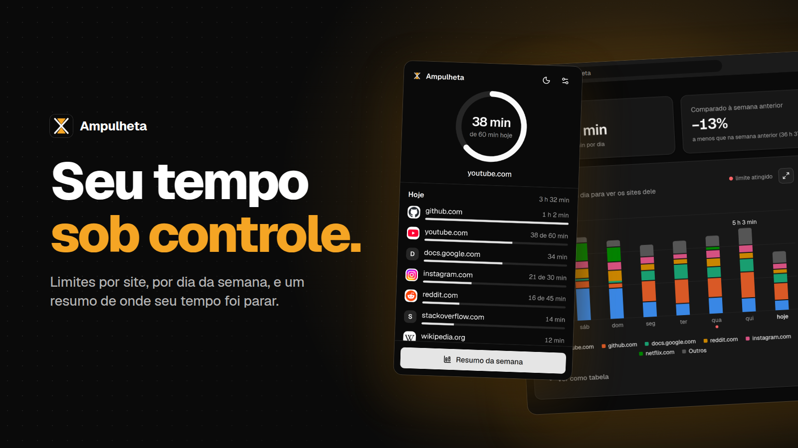
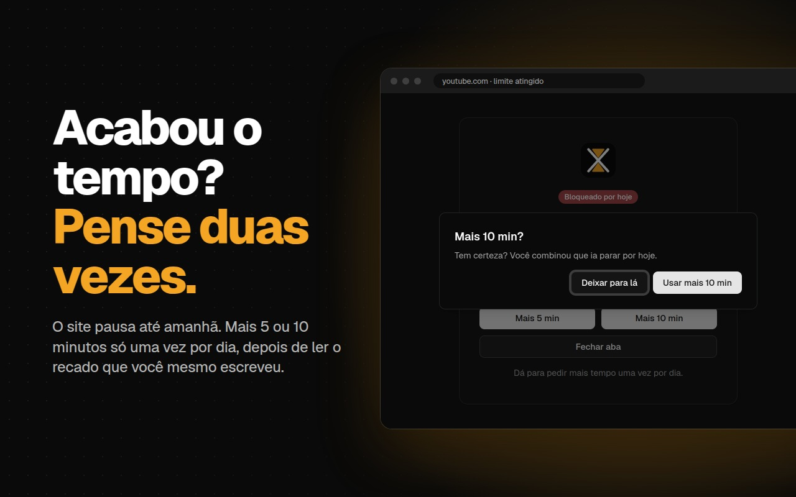
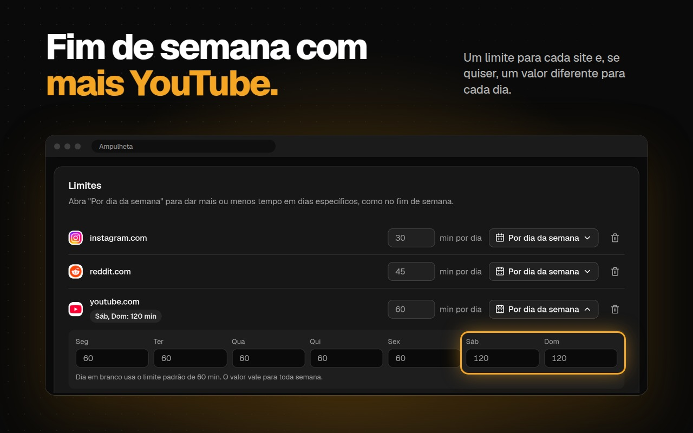
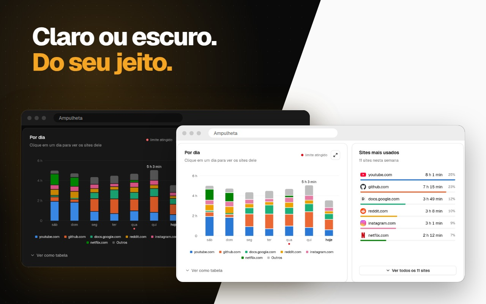

# Ampulheta



Extensão para Google Chrome (Manifest V3) que limita o tempo em sites escolhidos, principalmente o YouTube, e todo sábado mostra um resumo dos sites onde seu tempo foi parar.

Tudo fica no seu navegador (`chrome.storage.local`). Não há servidor, conta ou coleta de dados.

## O que faz

- **Conta o tempo por site** só quando a aba está ativa, a janela do Chrome está em foco e você não está ocioso. Vídeo tocando conta mesmo sem mexer no mouse. `www.youtube.com` e `m.youtube.com` contam como `youtube.com`.
- **Limite diário por site, com dias próprios.** O YouTube já vem com 60 min, e cada dia da semana pode ter um valor diferente: mais tempo no sábado e no domingo, por exemplo. Faltando 5 min chega um aviso; quando o limite estoura, a aba vai para uma tela de bloqueio com o botão **mais 5 min**, que pode ser usado uma vez por dia por site.
- **Popup** com um anel de progresso do site atual ("38 min de 60 hoje"), o tempo de hoje em cada site e o botão do resumo sempre à vista.
- **Resumo semanal** (sábado a sexta): tempo total, comparação com a semana anterior, dias em que os limites foram respeitados, gráfico por dia dividido por site e a lista de todos os sites usados. A notificação chega no sábado às 9h e o resumo também abre pelo popup.
- **Uma página só** para o resumo e para os sites e limites.
- Visual em preto e branco com [shadcn/ui](https://ui.shadcn.com/), tema claro e escuro automático. Histórico com mais de 90 dias é apagado sozinho.

| Tela de bloqueio | Sites e limites |
| --- | --- |
|  |  |



## Instalar

### Pela Chrome Web Store

Em breve.

### Sem compactação (desenvolvimento)

1. Baixe ou clone este repositório.
2. Instale as dependências e gere a extensão:

```bash
npm install
```

```bash
npm run build
```

3. Abra `chrome://extensions` e ative o **Modo do desenvolvedor**.
4. Clique em **Carregar sem compactação** e escolha a pasta `build/`.

Com `npm run dev` a pasta `build/` é refeita a cada alteração; depois é só recarregar a extensão em `chrome://extensions`.

## Testar

- **Limite e bloqueio:** na parte *Sites e limites* da página, coloque 1 ou 2 min no YouTube e assista um pouco.
- **Resumo sem esperar o sábado:** abra pelo botão do popup. Para ver com dados de exemplo, sem gravar nada, abra `dashboard/dashboard.html?demo` pela extensão.
- **Console do service worker:** em `chrome://extensions`, link *service worker* da Ampulheta.
- **Testes automatizados** (Node 22+), com um `chrome.*` simulado:

```bash
npm test
```

## Estrutura

```
public/              manifest.json e ícones (icon.svg e PNGs gerados por tools/make_icons.py)
background.js        service worker: contagem, limites e alarme de sábado
popup/               anel de progresso e lista de hoje
dashboard/           resumo semanal, sites e limites
blocked/             tela de limite atingido
shared/storage.js    leitura e gravação no chrome.storage.local
shared/theme.css     tokens do shadcn e base comuns
shared/ui/           componentes do shadcn/ui
tests/               testes do background e dos limites com Node
store/               imagens e textos da página na Chrome Web Store
```

As telas usam React, Tailwind CSS e shadcn/ui, com build pelo Vite. O `background.js` e o `shared/storage.js` continuam em JavaScript puro. Para adicionar um componente: `npx shadcn@latest add <nome>`.

## Publicar uma nova versão

1. Aumente `version` em `public/manifest.json`.
2. Gere o pacote com `npm run package`. Ele faz o build e o arquivo sai em `dist/ampulheta-<versão>.zip`, só com os arquivos da extensão.
3. No [painel do desenvolvedor](https://chrome.google.com/webstore/devconsole), abra a Ampulheta, envie o novo pacote em *Pacote* e clique em *Enviar para revisão*.

Os textos da página da loja estão em [`store/LISTING.md`](store/LISTING.md).

## Privacidade

A Ampulheta não envia nada para fora do navegador. Veja a [política de privacidade](PRIVACY.md).

## Licença

[MIT](LICENSE)
